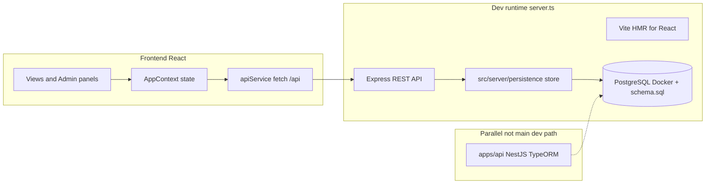

# پرامپت و توضیح کلی پروژه روم‌چی (Roomchi)

این سند برای گفت‌وگو با هوش مصنوعی دیگر آماده شده است. بلوک‌های پایین را می‌توانید عیناً کپی کنید.

---

## نمای کلی محصول

**روم‌چی** (برند UI: **روم‌چی / Roomchi**) یک سامانه **رزرو و مدیریت اتاق جلسات چند‌سازمانی (multi-tenant)** برای شرکت‌های ایرانی است. زبان رابط کاربری **فارسی** است (تقویم جلالی، فرمت زمان، کپی فارسی).

قابلیت‌های هدف (برخی در UI/متا آمده، برخی هنوز پیاده نشده):

- رزرو اتاق، تقویم، داشبورد، آنالیتیکس
- پنل ادمین: اتاق‌ها، رزروها، نقش‌ها (RBAC)، کنترل دسترسی، تنظیمات سازمان، اعلان‌ها، تیکت پشتیبانی
- تیم‌ها (Teams) برای گروه‌بندی کاربران
- احراز هویت: ورود، ثبت‌نام، OTP ایمیل (شبیه‌سازی)، فراموشی رمز، تکمیل پروفایل اجباری
- راه‌اندازی سازمان جدید (provisioning) از UI
- یکپارچگی آینده: Google Calendar، Outlook، تبلت دم درب (`metadata.json`)
- وابستگی `@google/genai` در `package.json` هست؛ در کد فعلی **استفاده مستقیم از Gemini در سورس دیده نشده** (احتمالاً برای AI Studio / آینده)



---

## ساختار مخزن (monorepo)

| مسیر | نقش |
|------|-----|
| `src/` | فرانت‌اند اصلی React 19 (اپ `web` در Nx به همین `src` اشاره می‌کند) |
| `server.ts` | **سرور اجرای روزمره**: bootstrap کوتاه؛ routeها در `src/server/registerApiRoutes.ts` |
| `src/server/persistence/` | CRUD PostgreSQL (orgs, rooms, bookings, users, teams, OTP) |
| `apps/api/` | **NestJS 12** در حال ساخت: auth، organizations، users، roles، teams؛ TypeORM entities؛ tenant middleware + JWT guards |
| `libs/shared-types/` | تایپ‌های مشترک (نقش‌ها، Booking، Team، NotificationSettings و …) |
| `schema.sql` | اسکیمای PostgreSQL + seed فارسی |
| `src/services/dbService.ts` | Pool Postgres برای API و `/api/db/status` |
| `docker-compose.yml` | Postgres 16 لوکال؛ `npm run dev` آن را بالا می‌آورد |

**اجرای محلی:** `npm run dev` → Docker Postgres + `tsx server.ts` روی پورت **3000**. راهنما: [SETUP.md](SETUP.md).

**Nx:** `nx.json` + `apps/web` و `apps/api`.

---

## معماری فرانت‌اند

- **ورودی:** `src/main.tsx` → `src/App.tsx`
- **State:** `src/context/AppContext.tsx` — تم، landing vs portal، org، تب، auth، RBAC، اعلان‌ها (بخشی localStorage)
- **API:** `src/services/apiService.ts` — `fetch('/api/...')` + `rooomchi_auth_token`
- **RBAC:** `src/constants/rbac.ts` — `super_admin`, `org_admin`, `room_manager`, `employee`
- **برند:** `src/constants/brand.ts` — لوگوی روم‌چی در `public/assets/logo/`
- **جلالی:** `src/utils/jalali.ts`

**تب‌ها:** dashboard، calendar، rooms، my-bookings، analytics، teams، profile، support؛ ادمین: admin-rooms، admin-bookings، admin-rbac، access-control، admin-settings، admin-notifications، admin-support-tickets.

---

## معماری بک‌اند (فعال: Express + PostgreSQL)

داده در **PostgreSQL** (`schema.sql` + `schema/02-server-extensions.sql`). seed دمو در `src/server/persistence/seed.ts` در اولین استارت.

**Endpointهای نمونه:** health، db/status، organizations، rooms، bookings، stats، auth (login/register/OTP/profile/password)، users، teams.

**JWT:** `@nestjs/jwt` در server.ts؛ secret فعلاً در فایل (production باید از env).

**Nest (`apps/api`):** هنوز جایگزین `npm run dev` نشده.

---

## دیتابیس

- `schema.sql` → `rooomchi_db`
- `.env.example` → `DATABASE_URL` یا `DB_*`
- CRUD API در `src/server/persistence/store.ts`؛ برخی state UI هنوز localStorage (اعلان، تیکت، …)

---

## تاریخچه کارها (خلاصه git)

1. Initial + monorepo  
2. Server + Vite یکپارچه  
3. Analytics UI  
4. برند روم‌چی و UI  
5. Auth + تکمیل پروفایل، OTP  
6. Landing / logout  
7. Protected roles  
8. Calendar / TimePicker  
9. Teams (API + UI + SQL)  
10. Access control (UI + localStorage)  
11. Notifications (UI/types)  
12. Refactor booking defaults  

---

## محدودیت‌ها برای AI بعدی

- Express monolith (فعال) vs Nest (در حال رشد) — مسیر هدف را مشخص کنید.
- Persistence واقعی = wire به Postgres یا مهاجرت Nest.
- JWT `organizationId` برای tenancy.
- بعضی صفحات ادمین ممکن است بیشتر UI/local باشند.
- RTL فارسی + جلالی.
- Repo: GitHub `mo-navabix/rooomchi`.

---

## پرامپت آماده (انگلیسی)

```
You are helping me on **Rooomchi** (روم‌چی) — an enterprise multi-tenant meeting room booking portal in Persian (RTL, Jalali calendar).

Stack:
- Monorepo (Nx): React 19 + Vite 8 + Tailwind 4 frontend in /src
- Daily dev server: /server.ts — Express REST API + Vite middleware on port 3000 (npm run dev)
- Parallel NestJS 12 app in /apps/api (TypeORM, JWT, tenant middleware) — NOT the main runtime yet
- Shared types in /libs/shared-types
- PostgreSQL schema in /schema.sql (organizations, users, rooms, bookings, teams, audit_logs, SSO-ready auth settings) — CRUD in server.ts is still in-memory arrays; DB pool only used for /api/db/status via src/services/dbService.ts

Frontend architecture:
- App.tsx routes tabs: dashboard, calendar, rooms, my-bookings, analytics, teams, profile, support; admin tabs for rooms, bookings, RBAC, access-control, settings, notifications, support tickets
- AppContext.tsx: auth, org switching, RBAC can(permission), theme, landing vs app mode, localStorage for token (rooomchi_auth_token) and some settings/notifications
- apiService.ts calls /api/* with Bearer token
- Roles: super_admin, org_admin, room_manager, employee (see src/constants/rbac.ts)

Backend (server.ts) highlights:
- JWT auth, multi-tenant filtering by organizationId
- Endpoints for orgs, rooms, bookings, stats, users, teams, auth (login, register, OTP simulated in memory, profile completion, password reset)
- Protected system admins (root@rooomchi.ir etc.) cannot be deleted
- In-memory seed data (e.g. org-1 TechNova) — data lost on server restart

Recent feature history: monorepo init, analytics UI, branding to Roomchi, auth + mandatory profile completion, protected roles, calendar/time picker improvements, teams CRUD, access control UI, notification system UI/types. Gemini dependency exists but no in-repo Gemini calls found yet.

When suggesting changes: prefer minimal diffs, match existing Persian UI copy, respect RBAC, and clarify whether to extend server.ts or Nest/Postgres migration path.

--- Session goal (fill in) ---
[YOUR GOAL HERE: e.g. wire bookings to PostgreSQL, complete Nest teams module, fix calendar bug]
Current branch: [BRANCH]
Files in focus: [PATHS]
Constraints: [frontend only | backend only | no schema changes]
```

---

## پرامپت آماده (فارسی)

```
من روی پروژه «روم‌چی» (برند UI: روم‌چی / Roomchi) کار می‌کنم — سامانه رزرو اتاق جلسه چند‌سازمانی با رابط فارسی، RTL و تقویم جلالی.

فنی:
- مونورپو Nx: فرانت React 19 در پوشه src با Vite و Tailwind 4
- اجرای روزمره: server.ts = Express + APIهای REST + در dev وسط‌افزار Vite؛ پورت 3000 (npm run dev)
- NestJS در apps/api با TypeORM و JWT آماده است اما هنوز جایگزین server.ts نشده
- تایپ‌های مشترک در libs/shared-types
- schema.sql اسکیمای PostgreSQL را دارد؛ ولی CRUD فعلی در server.ts روی آرایه‌های in-memory است؛ اتصال Postgres فعلاً بیشتر برای /api/db/status است

فرانت: AppContext مرکزی، apiService به /api، نقش‌ها super_admin / org_admin / room_manager / employee و permissionها در rbac.ts. تب‌های کاربری و ادمین (اتاق، رزرو، RBAC، کنترل دسترسی، تنظیمات، اعلان، پشتیبانی، تیم‌ها).

بک‌اند فعال server.ts: احراز هویت JWT، چند‌سازمانی، OTP و reset در حافظه، تیم‌ها و کاربران، ادمین‌های محافظ‌شده.

کارهای انجام‌شده: مونورپو، آنالیتیکس UI، برند روم‌چی، احراز هویت و تکمیل پروفایل، نقش‌های محافظ‌شده، بهبود تقویم، مدیریت تیم، ماژول کنترل دسترسی، سیستم اعلان (UI/تایپ).

لطفاً قبل از پیشنهاد تغییر بگو آیا باید server.ts را گسترش دهیم یا به Nest + Postgres مهاجرت کنیم؛ تغییرات کوچک و هم‌سبک کد موجود باشد.

--- هدف این جلسه (پر کنید) ---
[مثال: اتصال رزروها به Postgres / تکمیل API تیم در Nest / رفع باگ تقویم]
شاخه git: [نام شاخه]
فایل‌های در دست کار: [مسیرها]
محدودیت: [فقط فرانت | فقط بک | بدون تغییر schema]
```

---

## شخصی‌سازی سریع

| فیلد | مثال |
|------|------|
| هدف جلسه | «مهاجرت bookings از memory به Postgres در server.ts» |
| شاخه | `main` یا `feature/...` |
| فایل‌ها | `server.ts`, `schema.sql` |
| محدودیت | «بدون تغییر UI» |

پرامپت کامل پروژه + بخش «هدف جلسه» را با هم در چت AI مقصد paste کنید.
